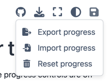
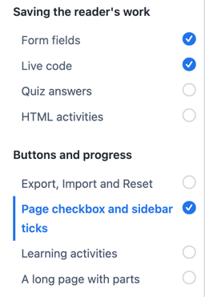

# sphinx-persistence

This extension saves your readers' work in a Jupyter Book, TeachBooks or Sphinx website.

Without it, everything a reader does in an interactive book is lost when they refresh or close the page. This includes quiz answers, code they edited and exercises they filled in. With this extension, all of it comes back when the reader returns, even days later. The extension stores everything in the reader's own browser. There is no server and no account, and no data leaves the reader's computer.

You can try every feature in the [example book](https://omarkammouh.github.io/sphinx-persistence-example/main/). Its source is in the [sphinx-persistence-example](https://github.com/omarkammouh/sphinx-persistence-example) repository.

## Installation

You need to add two lines and then rebuild your book.

1. Add this line to your book's `requirements.txt`:

   ```
   sphinx-persistence @ git+https://github.com/omarkammouh/sphinx-persistence
   ```

2. Add the extension to your book's `_config.yml`:

   ```yaml
   sphinx:
     extra_extensions:
       - sphinx_persistence
   ```

For a plain Sphinx project without Jupyter Book, add `"sphinx_persistence"` to the `extensions` list in `conf.py` instead.

The extension is not on PyPI yet. The line above installs the latest version from GitHub each time your book is built. To keep one version, add a commit id to the end of the line, for example `@46ce63b`.

With no further settings, the extension saves the reader's work and adds the Export, Import and Reset buttons to the page header. It adds nothing else to your pages. You can turn on the progress controls (checkboxes, ticks and clickable circles in the sidebar, and Reset buttons per activity) one by one, as [Settings](#settings) explains.

## Saving the reader's work

The extension saves the four kinds of work below, and saving is on by default.

### Form fields

The extension saves anything a reader types or selects in text boxes, text areas, checkboxes, radio buttons, dropdowns and sliders. It saves in the background a moment after each change, and once more when the reader leaves the page. So nothing is lost when a reader closes the tab in the middle of a sentence. When the reader comes back, every field is filled in as they left it. The extension also picks up fields that a script adds after the page has loaded.

This part is always on, because the other parts build on it. To keep one field out of saving, such as a search box, put `data-persistence="off"` on the field or on an element around it:

```html
<div data-persistence="off">
  <input type="text" placeholder="This field is not saved">
</div>
```

### Live code cells

If your book has executable code cells (thebe, or "Live Code"), the extension saves the code a reader writes or changes in a cell. The next time the reader opens the page, the code is back in the cell. The extension saves only the code and not the output, so the reader runs the cell again to see the output.

Each saved edit also remembers what the original cell looked like. If you later change that cell in a new version of your book, the old edit no longer matches, and the extension skips it. This way a reader never sees their code appear in a cell where it does not belong.

The extension also stops thebe's "unsaved work" pop-up when a reader leaves the page, because the work is already saved.

Turn it off with `persistence_code_cells: false`.

### Quiz answers

The extension saves answers to TeachBooks-Questions quizzes. It saves which option the reader picked in a multiple-choice question and what they typed into a math answer field. When the reader reloads the page, the answer is selected again. The extension does not show the feedback (correct or incorrect) again, so the reader presses Check to see it.

Turn it off with `persistence_questions: false`.

### Custom HTML activities

Many books contain small exercises written directly in HTML, such as sorting, matching and click-to-classify exercises. Normally another script cannot save these, because each activity keeps its state in its own code. This extension records the clicks a reader makes inside such an activity. When the reader reloads the page, the extension replays those clicks, and the activity rebuilds itself step by step. If the reader had pressed Check, the graded result comes back as well. You do not need to change the activities themselves.

An activity must sit inside an HTML element with an id, for example `<div id="sorting-exercise">`. The extension uses that id to know which activity a click belongs to. Clicks in an activity without such an id are not saved. Give every activity its own id, and keep the id the same in later versions of your book. If the id changes, readers lose their saved work in that activity.

Turn it off with `persistence_activities: false`. To skip single activities, such as timed games, list their ids in `persistence_activity_exclude_ids`.

## Export, Import and Reset

The extension adds three actions to the page header, and they are on by default. Without further settings, they show as three icon buttons: Export (a file with an arrow out), Import (a file with an arrow in) and Reset (a bin).


With `persistence_toolbar_menu: true`, the three actions sit in one menu behind a single disk icon in the page header. Each action has its name in the menu. This keeps the header short, and readers can see what each action does.



Saved work lives in one browser on one computer. Export and Import move it between computers. Export downloads one file with all saved work in the whole book, and Import loads such a file back in. A student can work in the university library, export the file and continue at home. The file also works as a backup in case the browser clears its storage.

The export file is a JSON file. It holds a format version (`schemaVersion`, now 2), the book id, the page title, the export date and the saved items. The book id comes from `persistence_book_id`. When that setting is empty, the extension reads a `<meta name="book-id">` tag, and otherwise it uses the website address.

Import checks the file first. If the file comes from a different book, the reader sees a warning before anything changes. Code edits that no longer match the current version of the book are skipped.

Reset lets a reader start over. It asks whether to clear only the current page ("Current Page Only") or the whole book ("Entire Book"). Then it deletes the saved work and reloads the page in its original state. It leaves other data of the website alone, with two exceptions on a shared web address that [Several books on one web address](#several-books-on-one-web-address) describes.

Turn all three actions off with `persistence_toolbar: false`.

## Progress controls

The extension can also add controls that help readers track how far they are. These controls are off by default, so readers of an existing book see no new buttons after you install the extension. Each control has its own setting, so you can turn on only the ones you want.

### Checkbox at the end of each page

With `persistence_page_checkbox: true`, every page ends with a "Mark this section as complete" checkbox. The reader ticks it when they are done with the page.


### Ticks in the sidebar

With `persistence_sidebar_ticks: true`, a tick appears at the right edge of the left sidebar next to every page the reader has marked complete. The reader can then see at a glance which pages they have finished. The ticks come from the page checkbox, so turn on `persistence_page_checkbox` as well, or use the clickable circles below.


### Clickable circles in the sidebar

With `persistence_sidebar_clickable: true`, every page in the left sidebar gets a small circle at the right edge. The reader clicks the circle to mark that page as done, and the circle turns into a filled tick. Clicking it again undoes it. The reader stays on the page they are reading. This works without the checkbox at the end of the page. When both are on, they stay in step, because they save the same value.



### "Mark as done" after each activity

With `persistence_activity_checkboxes: true`, every learning activity ends with a "Mark as done" checkbox. The extension finds learning activities in two ways. The first is an HTML element with `data-learning-activity="true"` that contains an element with the class `la-title`. The second is a heading that starts with "Learning activity:".

### Reset button after each activity

With `persistence_activity_reset: true`, every learning activity that is written in HTML ends with a "Reset" button. This button clears the saved answers of that one activity and reloads the page, so the reader can start the activity again. It keeps the "Mark as done" tick. Activities written as Markdown headings do not get this button, because they have no saved state of their own.

### Checkboxes on long pages

Some pages are long walkthroughs with numbered parts, such as "3.1.1: Setting up the model". You can give each numbered part its own "Mark as done" checkbox. Set `persistence_part_heading_pages` to a pattern that matches the web addresses of those pages, for example `"chapter_3|chapter_4"`. The pattern is a JavaScript regular expression. When the setting is empty, which is the default, no page gets these checkboxes.

## Limitations

### What does not get saved

- The output of code cells is not saved. Only the code is saved, and running it again brings the output back.
- Anything inside an iframe from another website, such as YouTube or H5P, is not saved. Browsers do not let a page look inside those.
- Canvas animations and games are not saved. They start again on purpose.
- The extension does not remember which tab of a tab set was open.

### Several books on one web address

A browser keeps saved work per web address, such as `https://oit.tudelft.nl`. When several books are hosted under the same address, they share one storage space, and the extension cannot yet tell them apart. This has three effects:

- Export puts the saved work of all books on that address into one file.
- Reset with "Entire Book" deletes the saved work of all books on that address. It also deletes saved H5P answers on that address.
- All books on the address share the browser's limit of about 5 MB.

Pages do not mix, because the extension saves each page under its own path. A book that has its own web address, such as a GitHub Pages site, is not affected. A fix that keeps each book's saved work apart is planned.

### Changes to your book

- A saved code edit belongs to the cell's position on the page. If you add or remove a code cell above it, the extension skips the old edit, so the reader does not see it in the wrong cell, but the edit is lost.
- A saved quiz answer, activity or checkbox belongs to the page path and its own id or title. If you rename a page, an activity id or an activity title, readers lose what they saved there.

### Theme

The extension is built for books that use the TeachBooks or sphinx-book-theme page layout. Export, Import and Reset go into that theme's page header. With another theme, they float in the bottom-right corner of the page, and the progress controls do not appear.

## Settings

All settings are optional. In a Jupyter Book or TeachBooks book, put them in `_config.yml` under `sphinx:` and then `config:`, next to your other Sphinx settings. In a plain Sphinx project, put them in `conf.py`. Rebuild the book after you change a setting.

This example puts Export, Import and Reset in one menu and turns on all progress controls:

```yaml
sphinx:
  extra_extensions:
    - sphinx_persistence
  config:
    persistence_toolbar_menu: true
    persistence_page_checkbox: true
    persistence_sidebar_ticks: true
    persistence_sidebar_clickable: true
    persistence_activity_checkboxes: true
    persistence_activity_reset: true
```

The table lists every setting in the order of this README.

| Setting | Default | What it does |
|---|---|---|
| `persistence_code_cells` | `true` | Saves the code readers write in live code cells. |
| `persistence_questions` | `true` | Saves TeachBooks-Questions answers. |
| `persistence_activities` | `true` | Saves custom HTML activities. |
| `persistence_activity_exclude_ids` | `[]` | Lists the ids of HTML activities that should never be saved, such as timed games. |
| `persistence_toolbar` | `true` | Shows the Export, Import and Reset buttons in the page header. |
| `persistence_toolbar_menu` | `false` | Puts Export, Import and Reset in one menu behind a single button in the page header. |
| `persistence_page_checkbox` | `false` | Adds a "Mark this section as complete" checkbox at the end of every page. |
| `persistence_sidebar_ticks` | `false` | Shows a tick in the sidebar next to completed pages. Needs `persistence_page_checkbox` or `persistence_sidebar_clickable`. |
| `persistence_sidebar_clickable` | `false` | Adds a circle next to every page in the sidebar. The reader clicks it to mark the page as done. |
| `persistence_activity_checkboxes` | `false` | Adds a "Mark as done" checkbox after every learning activity. |
| `persistence_activity_reset` | `false` | Adds a "Reset" button after every learning activity written in HTML. |
| `persistence_part_heading_pages` | `""` | Adds a "Mark as done" checkbox after numbered part headings on pages whose address matches this pattern, for example `"chapter_3\|chapter_4"`. |
| `persistence_book_id` | `""` | Gives your book a name. When a reader imports a file from a different book, they see a warning. Without a name, the extension uses the website address. |

## Good to know

- The extension saves work per browser and per computer. To move it to another computer, use Export on the first computer and Import on the second.
- Browsers give a website about 5 MB of storage. If a reader fills it, they get a warning, so no work is lost without notice.

## Contribute

Found a problem or have an idea? Open an [issue](https://github.com/omarkammouh/sphinx-persistence/issues), or fork the repository and open a pull request. Please describe what you did, what you expected and what happened, and name your browser.

The JavaScript files are in `src/sphinx_persistence/static/`. Sphinx serves the installed copy of the package. So after you edit a file, reinstall the package from your checkout before you rebuild the book you test with:

```
pip install --force-reinstall --no-deps /path/to/sphinx-persistence
```

The [example book](https://github.com/omarkammouh/sphinx-persistence-example) is a good place to test a change, because it uses every feature on a small number of pages.

## Licence

The extension is licensed under the [MIT licence](LICENSE).
